# Домашнее задание «Безопасность в облачных провайдерах»

Решение в Yandex Cloud:

1. содержимое бакета из [прошлого ДЗ](https://github.com/vpakspace/yc-compute-lb-hw) зашифровано ключом KMS — Terraform;
2. статический сайт в Object Storage на своём адресе открывается по HTTPS — `yc` CLI (по условию не Terraform).

Задание 2\* (AWS) не выполнялось: аккаунта AWS нет.

- [Что построено](#что-построено)
- [Задание 1. Шифрование бакета ключом KMS](#задание-1-шифрование-бакета-ключом-kms)
- [Статический сайт с HTTPS](#статический-сайт-с-https)
- [Как запустить](#как-запустить)
- [Очистка](#очистка)

## Что построено

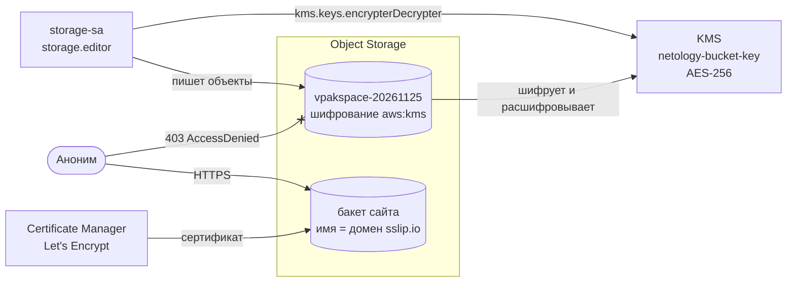

## Структура репозитория

| Путь | Что внутри |
|---|---|
| [`terraform/kms.tf`](terraform/kms.tf) | симметричный ключ KMS |
| [`terraform/storage.tf`](terraform/storage.tf) | бакет с шифрованием по умолчанию и объект в нём |
| [`terraform/iam.tf`](terraform/iam.tf) | `storage-sa`, роли на каталог и на ключ |
| [`terraform/`](terraform) | провайдер, переменные, outputs, зеркало провайдеров ([`.terraformrc`](terraform/.terraformrc)) |
| [`scripts/check.sh`](scripts/check.sh) | проверка: настройки бакета, метаданные объекта, анонимный и авторизованный доступ |
| [`scripts/probe_editor.sh`](scripts/probe_editor.sh) | чтение объекта аккаунтом с ролью `editor` и без токена |
| [`scripts/site.sh`](scripts/site.sh) | сайт, сертификат и HTTPS через `yc` |
| [`scripts/rollout.sh`](scripts/rollout.sh) | ожидание, пока новый сертификат отдают все соединения |
| [`scripts/make_picture.py`](scripts/make_picture.py) | картинка для бакета (из прошлого ДЗ) |
| [`site/`](site) | страницы сайта |
| [`logs/`](logs) | выводы команд (ID каталога, облака и организации заменены на `<…_id>`) |
| [`img/`](img) | скриншоты |

## Задание 1. Шифрование бакета ключом KMS

### Ключ и настройка бакета

Ключ — [`terraform/kms.tf`](terraform/kms.tf):

```hcl
resource "yandex_kms_symmetric_key" "bucket" {
  name              = var.kms_key_name # netology-bucket-key
  description       = "Шифрование содержимого бакета ${var.bucket_name}"
  default_algorithm = "AES_256"
  rotation_period   = "8760h" # новая основная версия раз в год, прежние сохраняются
}
```

В бакет из прошлого ДЗ добавлен один блок — [`terraform/storage.tf`](terraform/storage.tf):

```hcl
dynamic "server_side_encryption_configuration" {
  for_each = var.encryption_enabled ? [yandex_kms_symmetric_key.bucket.id] : []

  content {
    rule {
      apply_server_side_encryption_by_default {
        kms_master_key_id = server_side_encryption_configuration.value
        sse_algorithm     = "aws:kms"
      }
    }
  }
}
```

Флаг `encryption_enabled` (по умолчанию `true`) нужен, чтобы сначала воспроизвести бакет «как был» и сравнить
поведение до и после. Права: `storage-sa` получает `storage.editor` на каталог и
`kms.keys.encrypterDecrypter` **на этот ключ**, а не на все ключи каталога.

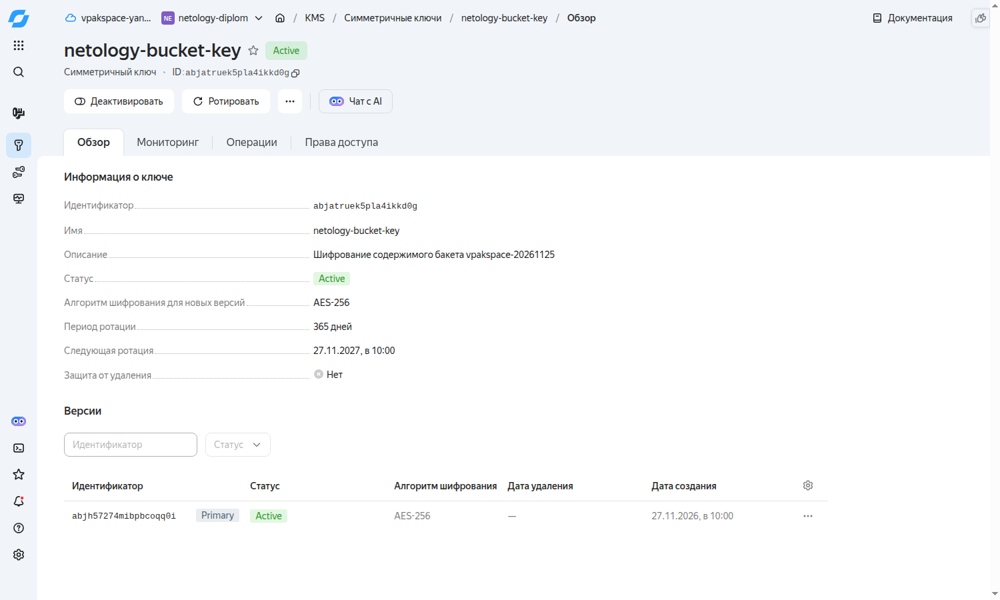

### Шаг 1. Бакет из прошлого ДЗ, без шифрования

Стенд прошлого ДЗ после сдачи был удалён, поэтому бакет воссоздан: то же имя `vpakspace-20261125`, те же флаги
анонимного доступа и та же картинка (sha256 файла совпадает с файлом из прошлого репозитория).

`terraform apply -var encryption_enabled=false` ([лог](logs/01_apply_without_encryption.log)):

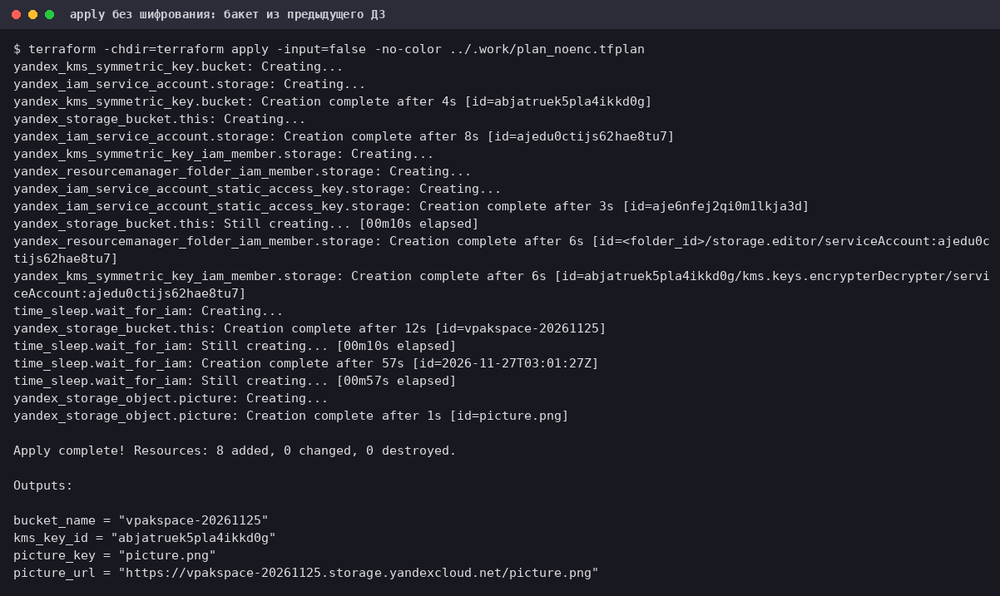

Проверка `scripts/check.sh` ([лог](logs/02_check_before.log)): в метаданных объекта нет признаков шифрования,
анонимный запрос возвращает картинку (HTTP 200).

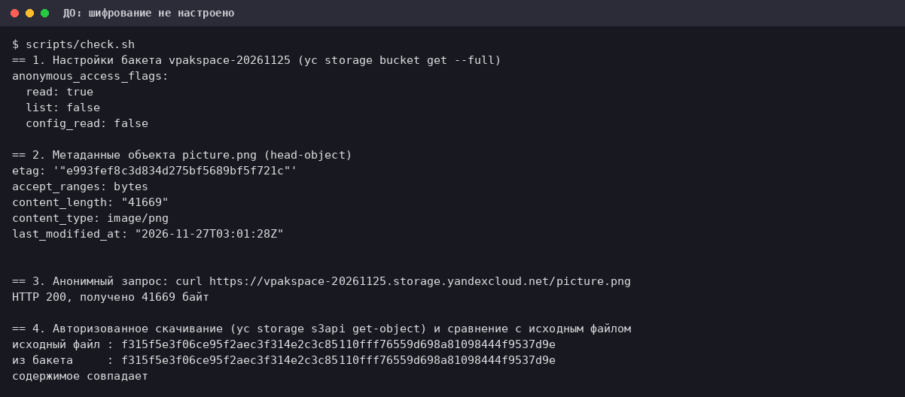

### Шаг 2. Включаем шифрование — старый объект не меняется

`terraform apply` меняет только бакет ([лог](logs/03_enable_encryption.log)):

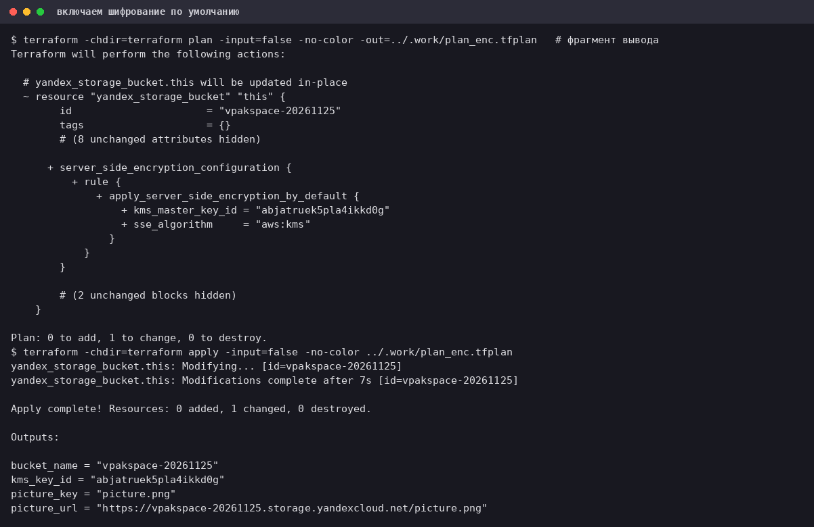

Настройка у бакета появилась, но уже лежащий объект остался незашифрованным и **по-прежнему отдаётся анонимно**
([лог](logs/04_check_old_object.log)). Шифрование по умолчанию действует только на новые записи.

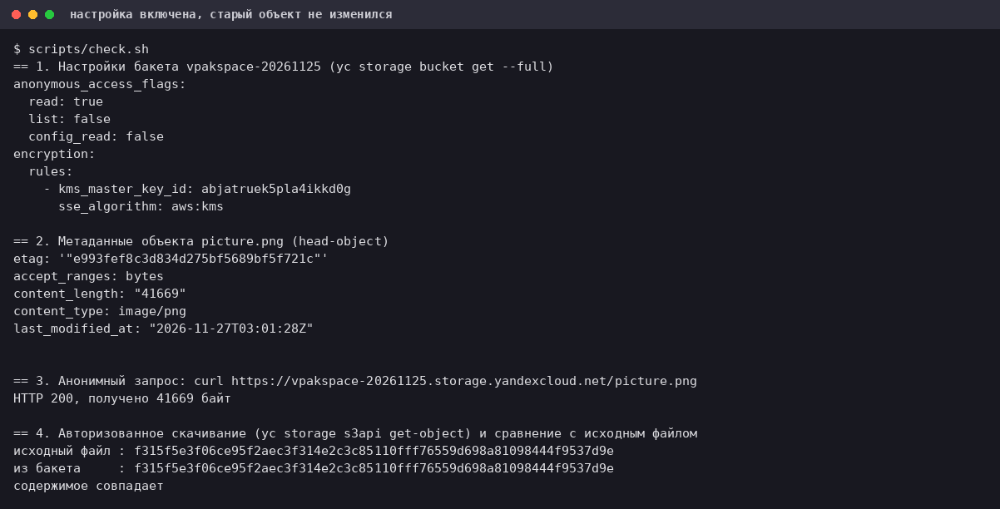

### Шаг 3. Перезаписываем объект

`terraform apply -replace=yandex_storage_object.picture` ([лог](logs/05_reupload.log)):

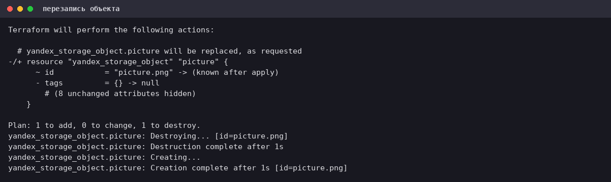

Теперь объект зашифрован ([лог](logs/06_check_encrypted.log)):

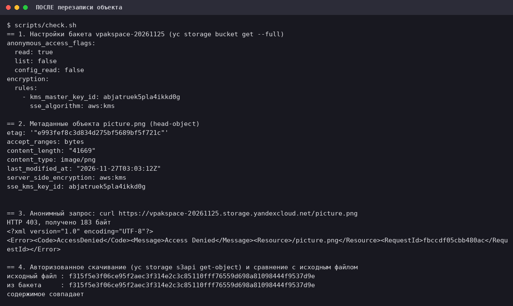

| Состояние | `server_side_encryption` | Анонимный GET | Скачивание через `yc` |
|---|---|---|---|
| без шифрования | нет | 200 | совпадает с исходным файлом |
| настройка включена, объект старый | нет | 200 | совпадает |
| объект перезаписан | `aws:kms` + ID ключа | **403 AccessDenied** | совпадает |

- Флаг анонимного чтения во всех трёх случаях один и тот же (`read: true`) — поведение изменило именно шифрование.
- Для того, у кого есть права, расшифровка прозрачна: те же байты, что и в исходном файле (sha256 совпадает).
- `ETag` после шифрования не изменился, поэтому смотреть нужно на поле `server_side_encryption`.

Повторный `terraform plan` расхождений не находит ([лог](logs/07_plan_no_changes.log)).

В консоли: ключ выбран на вкладке «Безопасность → Шифрование», у объекта указаны ID ключа и алгоритм. При этом
доступ объекта всё ещё подписан как «Публичный», хотя анонимно он уже не читается.

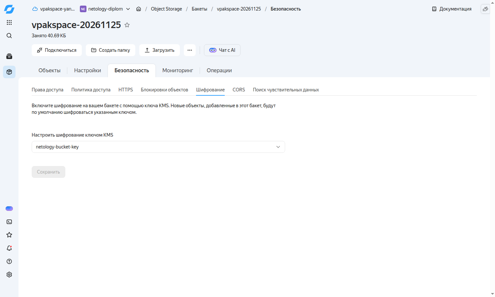

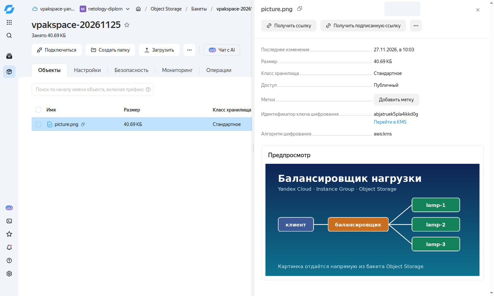

### От чего это шифрование не защищает

Временный `admin` снят ([роли после этого](logs/08_iam_roles.log)). У сервисного аккаунта `terraform` осталась
роль `editor` на каталог; прямых ролей на облаке, организации и самом ключе у него нет.
[`scripts/probe_editor.sh`](scripts/probe_editor.sh) запрашивает объект IAM-токеном, полученным по авторизованному
ключу этого аккаунта, и для сравнения — без токена ([лог](logs/09_editor_can_decrypt.log)).

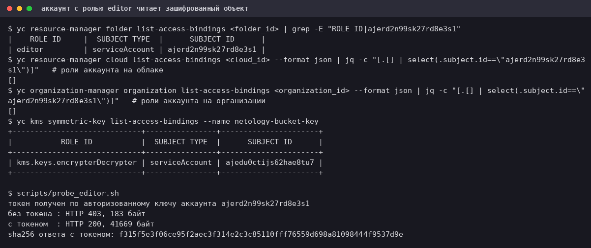

Без токена — 403, с токеном аккаунта — HTTP 200 и расшифрованный объект (sha256 тот же, что у исходного файла).
Примитивная роль `editor` по [документации](https://yandex.cloud/ru/docs/iam/roles-reference#editor) даёт
управление любыми ресурсами, кроме назначения ролей, передачи прав на организацию и её удаления и удаления ключей
KMS. Значит, шифрование закрывает от анонимного чтения объекты, записанные после его включения (защита от случайной
публикации), но не от участников с широкими ролями вроде `editor`. Чтобы разграничить и их, вместо примитивных
ролей нужны сервисные.

## Статический сайт с HTTPS

Эта часть по условию сделана не в Terraform: все действия — в [`scripts/site.sh`](scripts/site.sh) через `yc`.
Стенд после проверки [удалён](#очистка), поэтому адрес сайта больше не открывается — результат на скриншотах.

### Адрес

Своего домена нет, поэтому использовано имя сервиса [sslip.io](https://sslip.io):
`vpakspace.213-180-193-247.sslip.io` резолвится в `213.180.193.247` — это адрес `website.yandexcloud.net`.
Бакет назван так же, как домен: Object Storage выбирает бакет по имени из запроса. Для имени, под которым бакета
нет, тот же адрес отвечает `NoSuchBucket` ([конец лога](logs/10_site_bucket.log)).

Ограничения такого решения: домен принадлежит стороннему сервису, а IP-адрес — Яндексу и может смениться, тогда имя
перестанет вести на сайт. Для настоящего сайта нужен свой домен с записью `CNAME` на
`<домен>.website.yandexcloud.net`.

### Бакет и страница

```bash
scripts/site.sh bucket
```

Команда создаёт бакет с публичным чтением, включает хостинг (`index.html`, `error.html`) и загружает страницы из
[`site/`](site) ([лог](logs/10_site_bucket.log)). Этот бакет **без** шифрования KMS: посетители анонимны, а, как
показано выше, анонимно зашифрованный объект не читается.

После первой загрузки страница ещё правилась; повторно загружает её `scripts/site.sh pages`. Финальная версия на
сайте совпадает с [`site/index.html`](site/index.html) по md5 (это в том же логе).

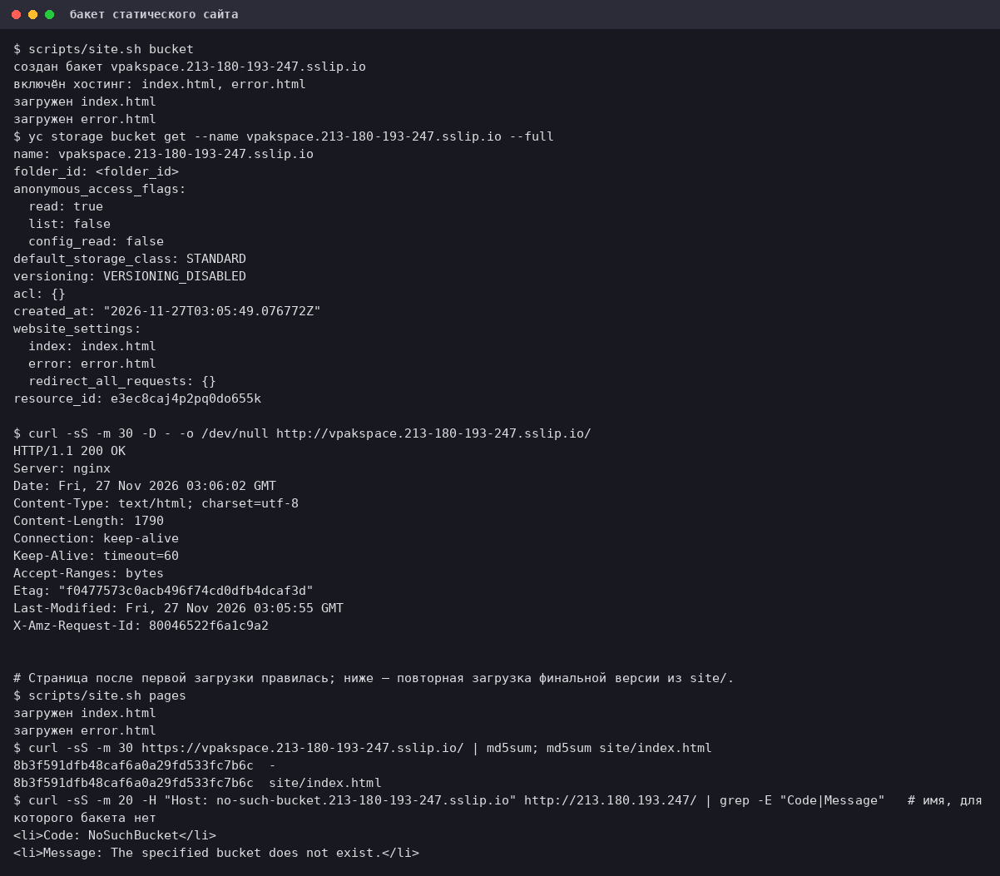

Пока сертификата нет, сайт открывается только по HTTP, и браузер пишет «Не защищено»:

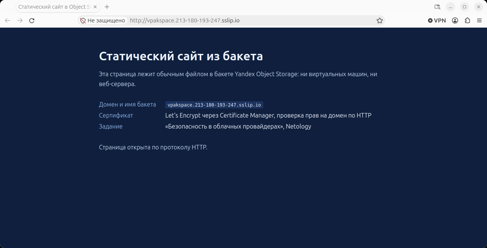

### Сертификат

```bash
scripts/site.sh cert     # запросить сертификат и положить в бакет файл проверки
scripts/site.sh status   # дождаться ISSUED
```

Внутри — `yc certificate-manager certificate request --domains <домен> --challenge http`. Certificate Manager
выдаёт путь и содержимое файла, скрипт кладёт его в бакет по пути `.well-known/acme-challenge/…`, а Let's Encrypt
читает файл по HTTP. От запроса до выпуска прошло 7,5 минут: `created_at` 03:06:09Z, `issued_at` 03:13:36Z
([запрос](logs/11_certificate.log), [выпуск](logs/12_certificate_issued.log)).

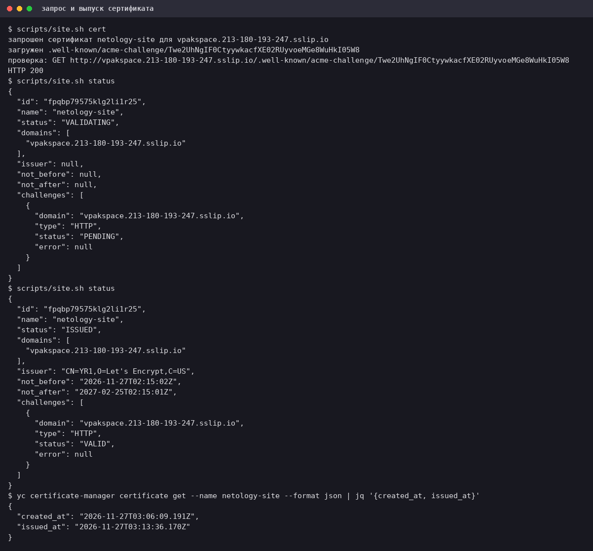

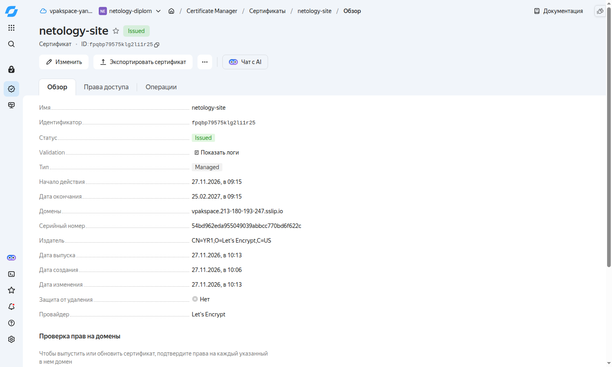

### Привязка к бакету

```bash
scripts/site.sh https
```

Команда выполняет `yc storage bucket set-https --certificate-id …` и удаляет из бакета ненужный больше файл проверки
([лог](logs/13_set_https.log)).

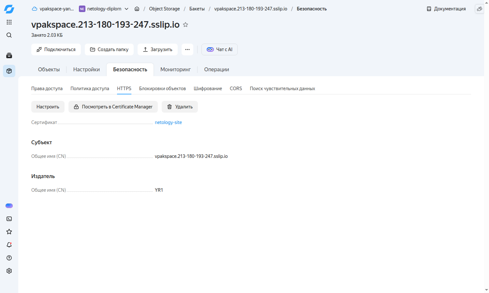

Новый сертификат начинает отдаваться не сразу ([лог](logs/14_https_rollout.log)). Привязка выполнена около 03:14Z:

- 03:14:30Z — сервер предъявляет общий сертификат `*.storage-1.yandexcloud.net`;
- 03:18:25Z — первый успешный запрос фонового ожидания, а в 03:18:29Z другое соединение снова получает старый;
- 03:18:58Z — из серии в 20 соединений проверку проходят 4;
- к 03:27:56Z — три серии 20 из 20 подряд, то есть около 14 минут от привязки (по документации YC — до получаса).

Около 03:19Z команда привязки выполнялась повторно с тем же сертификатом (в скрипт добавилось удаление файла
проверки). Первые успешные соединения появились раньше; влиял ли повтор на дальнейшую скорость, не проверялось.
Замеры сделаны черновой копией цикла; в [`scripts/rollout.sh`](scripts/rollout.sh) после этого домен вынесен в
переменную `DOMAIN` и исправлен код возврата ([прогон этой версии](logs/16_rollout_script.log)).

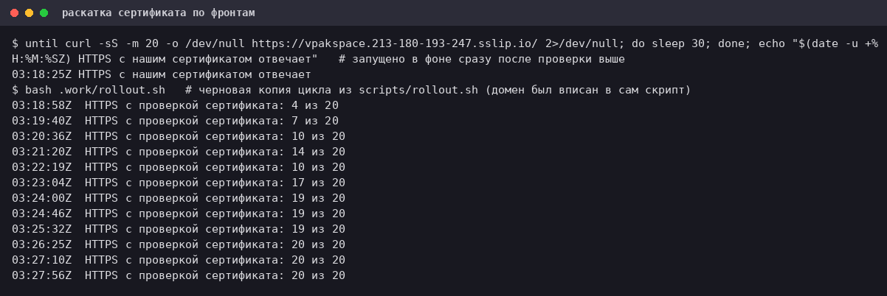

### Проверка

`scripts/site.sh check` после раскатки: HTTPS отвечает 200, сертификат выдан на домен центром Let's Encrypt и проходит
проверку, а HTTP теперь перенаправляет на HTTPS кодом 301 ([лог](logs/15_https_check.log)).

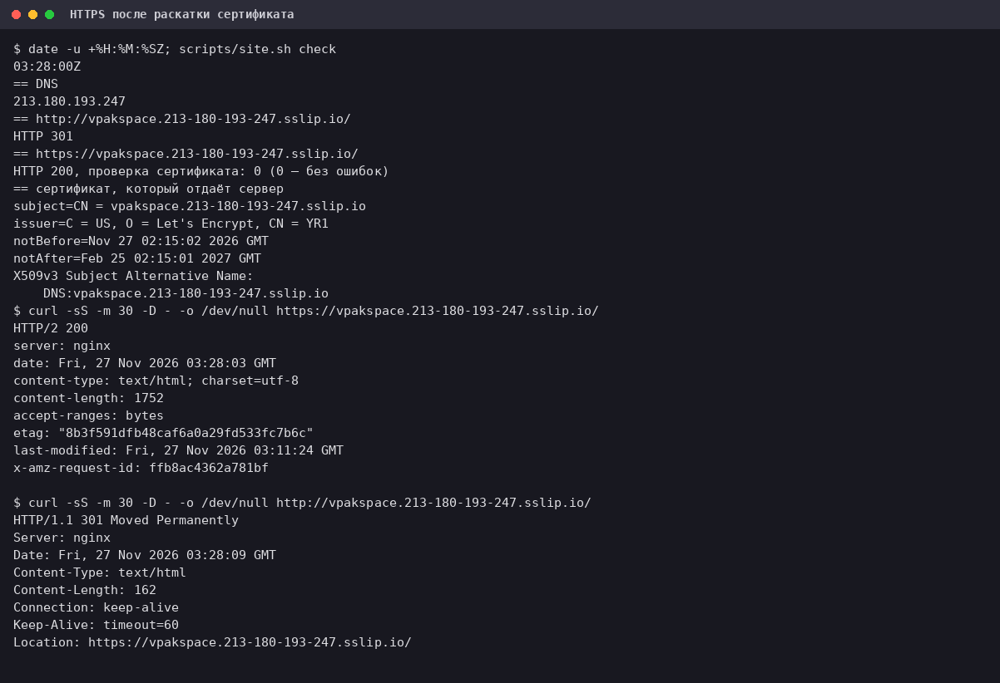

### Результат: сайт с замочком

Страница открыта в Firefox 157. В этой версии в адресной строке вместо отдельного замка стоит щит с галочкой:

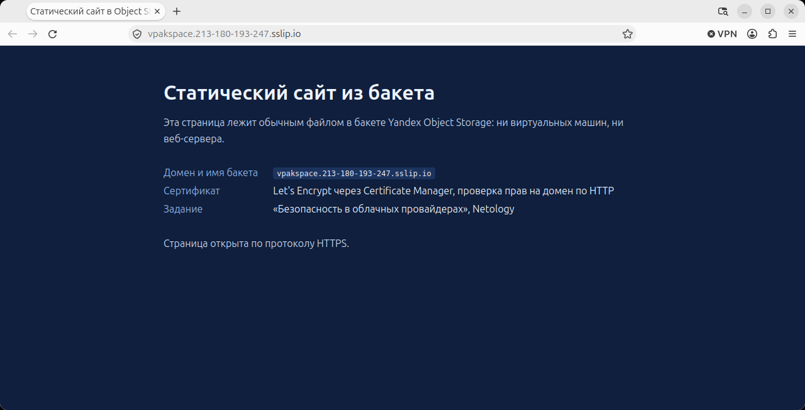

Замок и «Защищённое соединение» — в панели по щелчку на щит:

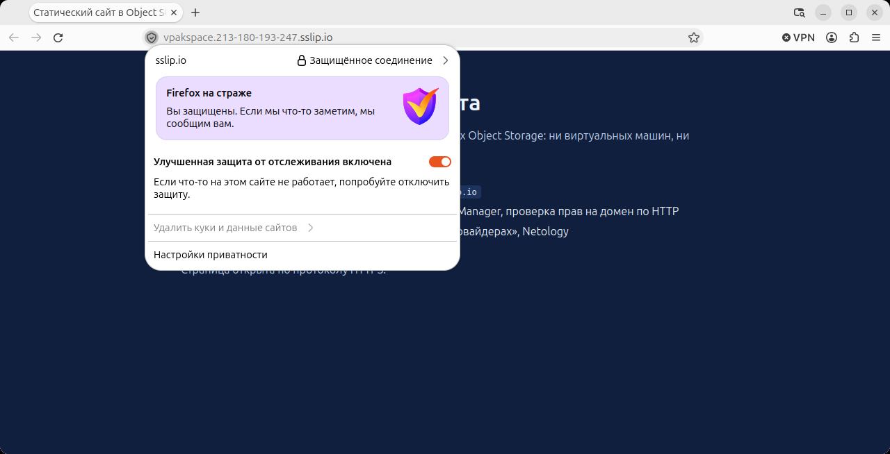

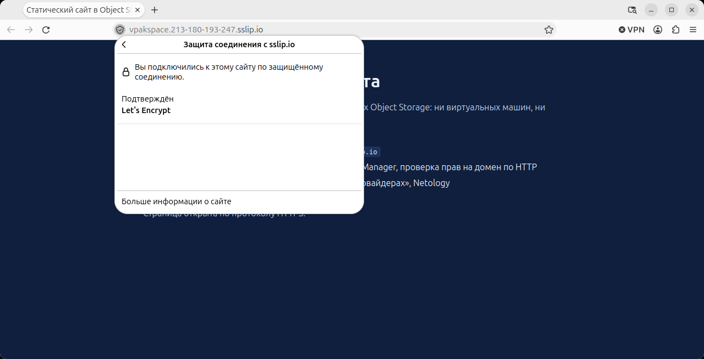

## Как запустить

Нужны Terraform 1.12, `yc` с настроенным профилем, `curl`, `jq`, `openssl`, `python3` с PyJWT и cryptography (для
`probe_editor.sh`) и авторизованный ключ сервисного аккаунта `terraform` (роль `editor`) в `~/.authorized_key.json`.

Назначать роли и удалять ключ KMS роль `editor` не позволяет, поэтому владелец облака на время `apply` и `destroy`
выдаёт аккаунту `admin` на каталог:

```bash
yc resource-manager folder add-access-binding <folder_id> --role admin --subject serviceAccount:<id_SA_terraform>

cd terraform
cp personal.auto.tfvars_example personal.auto.tfvars     # вписать cloud_id и folder_id
export TF_CLI_CONFIG_FILE=$PWD/.terraformrc              # зеркало провайдеров, если registry.terraform.io недоступен
terraform init

terraform apply -var encryption_enabled=false            # 1. бакет как в прошлом ДЗ
../scripts/check.sh
terraform apply                                          # 2. включить шифрование
../scripts/check.sh
terraform apply -replace=yandex_storage_object.picture   # 3. перезаписать объект
../scripts/check.sh
cd ..

yc resource-manager folder remove-access-binding <folder_id> --role admin --subject serviceAccount:<id_SA_terraform>
scripts/probe_editor.sh                                  # чтение объекта аккаунтом editor (после снятия admin)
```

Имена бакетов уникальны на весь Yandex Cloud. Если имя занято, задайте своё: переменную Terraform `bucket_name`
(и `BUCKET=<имя>` для `probe_editor.sh`), а для сайта — `DOMAIN` (домен в `site/index.html` тоже поправьте).

Сайт:

```bash
export DOMAIN=vpakspace.213-180-193-247.sslip.io   # своё имя, если это занято
scripts/site.sh bucket
scripts/site.sh cert
scripts/site.sh status     # повторять, пока не станет ISSUED
scripts/site.sh https
scripts/rollout.sh         # дождаться, пока новый сертификат отдают все соединения
scripts/site.sh check
```

## Очистка

```bash
scripts/site.sh down       # объекты и бакет сайта, сертификат (с тем же DOMAIN)

yc resource-manager folder add-access-binding <folder_id> --role admin --subject serviceAccount:<id_SA_terraform>
terraform -chdir=terraform destroy
yc resource-manager folder remove-access-binding <folder_id> --role admin --subject serviceAccount:<id_SA_terraform>
```

⚠️ Вместе с ключом KMS теряется возможность расшифровать всё, что им зашифровано.

Стенд удалён 27.11.2026 ([лог](logs/17_destroy.log)): объекты и бакет сайта, сертификат и 8 ресурсов Terraform. В
каталоге не осталось бакетов, ключей KMS и сертификатов; из сервисных аккаунтов остался `terraform` с одной ролью
`editor`. Сразу после удаления адрес сайта ещё перенаправлял с HTTP на HTTPS, а по HTTPS (без проверки сертификата)
отвечал `NoSuchBucket`.
